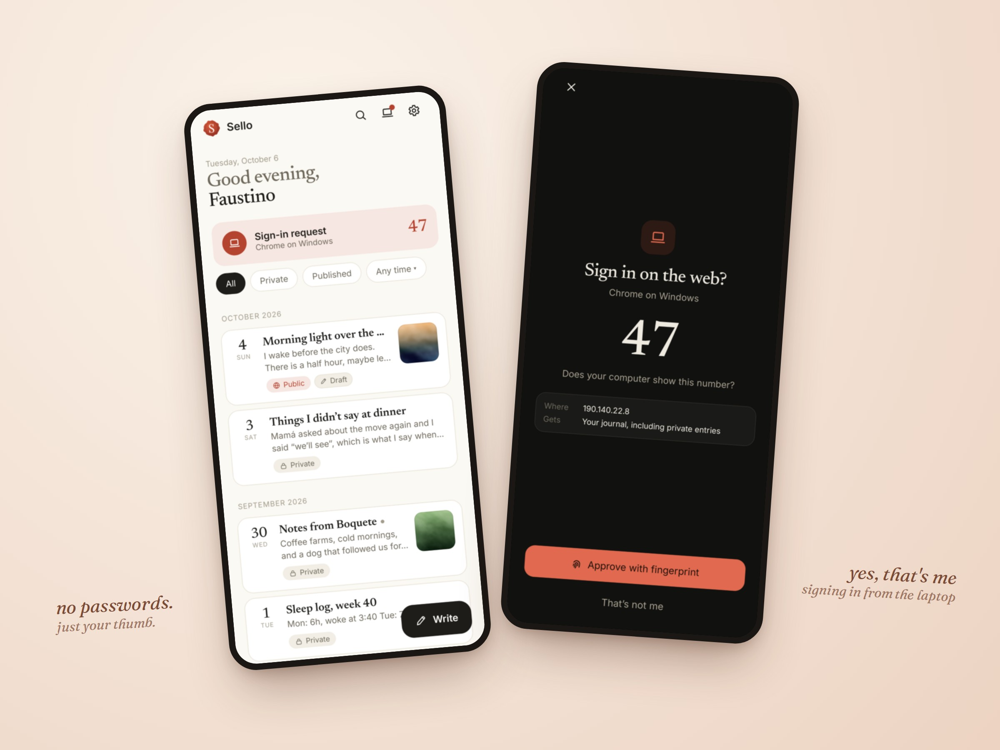
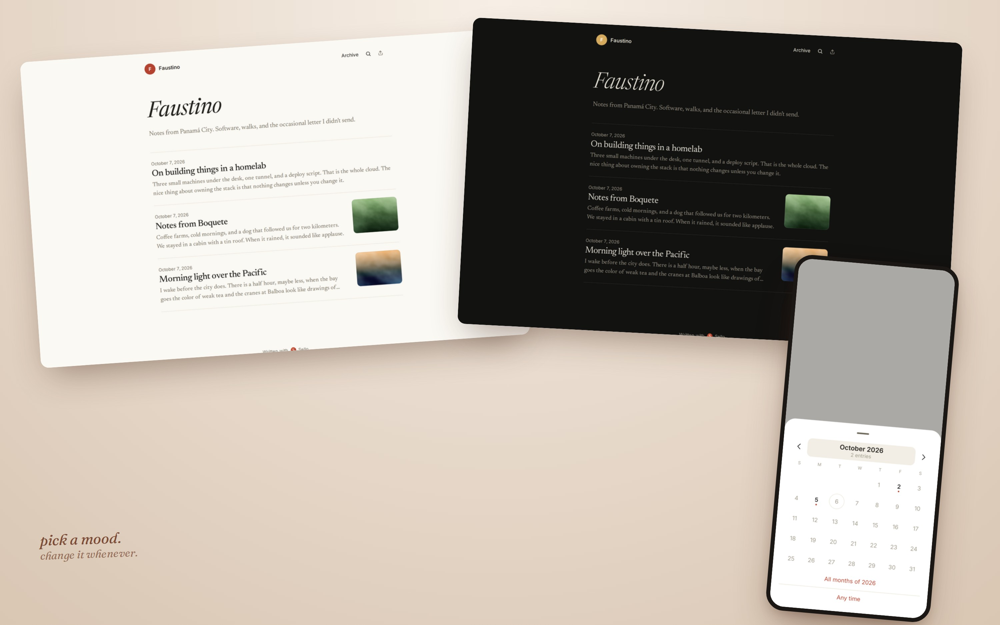
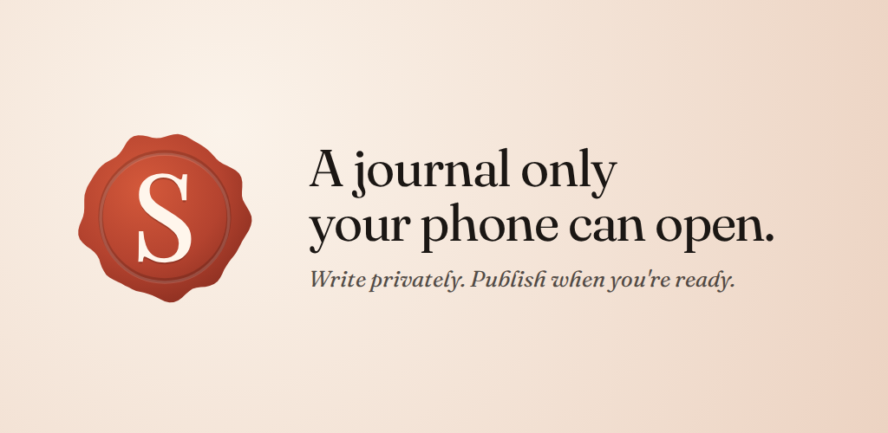

# store-shots

Marketing images from app screenshots, rendered by a headless browser.



- **compose**: phones and browser windows on a soft gradient, tilted a little, with handwritten-style notes. One JSON file per image.
- **pad**: fits screenshots into Google Play's 2:1 aspect limit by extending the edge color, so tall phone screenshots are accepted.
- **feature**: a 1024x500 feature graphic from a logo, a title and a subtitle.

## Install

```sh
npm install -g github:voypalante/store-shots
npx playwright install chromium
```

Or run it from a clone with `node bin/store-shots.mjs`. To use a browser you already have, set `CHROME=/path/to/chrome`.

## compose

```sh
store-shots compose examples/two-phones.json -o two-phones.jpg
```

```json
{
  "width": 1600,
  "height": 1200,
  "background": { "from": "#fbf3ea", "to": "#ecd3c2", "at": "30% 20%" },
  "items": [
    { "type": "phone", "src": "screens/journal.png", "x": 330, "y": 150, "width": 420, "rotate": -5 },
    { "type": "phone", "src": "screens/approve.png", "x": 830, "y": 110, "width": 420, "rotate": 4 }
  ],
  "notes": [
    { "text": "no passwords.", "sub": "just your thumb.", "x": 90, "y": 950, "rotate": -3 },
    { "text": "yes, that's me", "sub": "signing in from the laptop", "align": "right", "right": 70, "y": 900 }
  ]
}
```

| Field | Meaning |
|---|---|
| `width`, `height` | Canvas size in CSS pixels. `--scale` (default 1.5) multiplies the output resolution |
| `background` | Radial gradient: `from` at the point `at`, fading to `to` |
| `items[]` | `type` is `phone` (dark bezel, rounded) or `window` (white, rounded, no bezel). `src` is relative to the JSON file. `x`, `y`, `width`, `rotate`, `z`; phones also take `bezel` and `radius` |
| `notes[]` | `text` and an optional smaller `sub` line. Place with `x`/`y`, or `align: "right"` with `right`. `size` in px, `rotate` in degrees |
| `ink`, `font` | Note color and font (default: Fraunces from Google Fonts, then Georgia) |
| `out` | Default output file; `.jpg` or `.png` |



## pad

```sh
store-shots pad screenshots/*.png -o padded --ratio 2
```

Google Play accepts screenshots whose long side is at most twice the short side. Modern phones are taller than that (a 1080x2400 screenshot is 2.22:1), so `pad` widens each image to exactly 2:1, filling with the color at the middle of its left edge.

## feature

```sh
store-shots feature --title "A journal only\nyour phone can open." \
  --subtitle "Write privately. Publish when you're ready." --logo logo.svg -o feature.png
```



Options: `--from`, `--to` (gradient), `--color` (text), `--font`.

The example screenshots are from [Sello](https://sello.voypalante.com).

## License

MIT
